# TiDB Link 开发者工具包

[English](README.md) | 简体中文

> 翻译基线：英文文档提交 [`a152eb4`](https://github.com/mem9-ai/tidblink-dev-guide/commit/a152eb4abcc08a6241fec90d41efd8e1b3989872)（2026-10-21）。接口定义以共用 OpenAPI 为准。

通过 **TiDB Link Customer API**（`/api/v1`），为你的应用用户接入 **TiDB Link** 智能体：支持文本与语音交互，也能控制你的硬件。目前，将 Connector 关联到模板还需要 Console 访问权限。

本工具包有两种使用方式：

1. **配合 AI 编程助手（推荐）。** 工具包以 Skill 形式组织：让助手读取 `SKILL.md`，再要求它将 TiDB Link 集成到你的项目中。助手会沿着接入流程操作，以随附 OpenAPI 契约为准，提供可运行的原始 HTTP 请求，无需 TiDB Link SDK。
2. **作为文档阅读。** 从[架构](references/zh-CN/architecture.md)和[接入流程](references/zh-CN/development-path.md)开始。在浏览器中打开 `references/api-reference.html` 可查看全部操作；精确的协议细节见 `references/openapi.yaml`。完整 API 参考目前为英文，中英文指南共用同一份契约。

## 架构

密钥由你的后端保管；客户端仅获得短期授权；硬件只连接你自己的设备服务器，平台通过 Connector 调用该服务器。详见[架构](references/zh-CN/architecture.md)。

## 接入流程

| 阶段 | 要做的事 | 凭据 |
| --- | --- | --- |
| 0. 准备 | 签发组织 API 密钥；确认部署就绪 | Console |
| 1. 定义智能体 | 发布 Skill（可选）；创建智能体模板 | 组织 API 密钥 |
| 2. 配置用户 | 映射应用用户；创建终端用户；签发用户 API 密钥 | 组织 API 密钥 |
| 3. 接入设备 | 搭建设备服务器；将其注册、连接并激活为 Connector；从模板引用它 | 组织 API 密钥 · Console |
| 4. 文本对话 | 创建 Agent 和 Session；订阅 SSE；发送消息；渲染事件 | 用户 API 密钥 |
| 5. 语音对话 | 开启 Realtime；连接客户端 WebSocket；传输音频 | 用户 API 密钥 |

没有硬件时跳过阶段 3。详见[接入流程](references/zh-CN/development-path.md)。

## 内容目录

| 路径 | 用途 |
| --- | --- |
| `SKILL.md` | AI 助手入口：文档路由、凭据、范围与安全规则。 |
| `references/zh-CN/architecture.md` | 开发者需要理解的架构。 |
| `references/zh-CN/development-path.md` | 阶段 0–5，包含各项请求与完成标准。 |
| `references/zh-CN/reliability.md` | 幂等性、ETag、SSE 恢复、重试与错误排查。 |
| `references/zh-CN/protocols/connectors.md` | 搭建 Connector（设备服务器）：调用上下文、传输方式、错误与完整示例。 |
| `references/zh-CN/protocols/realtime-voice.md` | `tidb-link.realtime.v1` 语音协议。 |
| `references/openapi.yaml` | 上游 TiDB Link Customer API 契约；参见[来源版本与兼容性](references/zh-CN/upstream.md)。 |
| `references/api-reference.html` | 同一份契约的可视化参考（英文）。 |
| `references/zh-CN/diagrams/` | 架构图和接入流程图（SVG）。 |
| `agents/openai.yaml` | Skill 界面元数据。 |

中文版的术语、翻译基线和同步规则见[翻译维护说明](references/zh-CN/TRANSLATION.md)。

## 前提条件

- **`TIDB_LINK_BASE_URL`**：TiDB Link 部署的服务根地址。
- **`TIDB_LINK_ORG_KEY`**：组织 API 密钥（Organization API Key，`ti_org_…`），由组织所有者在 Console 签发。
- **阶段 3 额外要求**：拥有一个能够编辑**同一组织**模板的 Console 账号。MSP 创建的受管组织不会自动拥有 Console 成员；开始设备接入前，请联系组织管理员安排权限。仅凭组织 API 密钥无法完成步骤 12。多副本部署优先采用提供公网 HTTPS 地址的 `streamable_http` Connector；参见 [tunnel 限制](references/zh-CN/protocols/connectors.md#multi-replica-limit)。
- **`TIDB_LINK_USER_KEY`**：某个终端用户（End User）的用户 API 密钥（User API Key，`ti_user_…`），在阶段 2 使用组织 API 密钥签发。

所有密钥都应作为机密保管：放在后端的密钥管理系统中，绝不能放进代码、日志、URL、浏览器、固件或聊天内容。

## 安全模型

以 OpenAPI 契约中操作级的 `security` 为准，权限范围由存储的密钥决定：组织 API 密钥负责配置和资源开通，不能以用户身份执行操作；用户 API 密钥只能访问其所属终端用户的资源；Connector Key 只用于设备服务器通道的身份验证；Realtime 的 `connectToken` 有效期为 60 秒，只能建立一次语音连接。机密值只返回一次，应立即保存；丢失后需轮换，不能重新索取。本工具包的任何步骤都不要求你把密钥粘贴到对话中。
