# Architecture

English | [简体中文](zh-CN/architecture.md)

What a developer needs to understand before writing the first request: who holds which credential, how a Template becomes a conversation, and how text, voice and devices reach the Agent.

## Three columns

**Your system** — everything you build and operate:

- **Console** (manual): an Organization Owner issues the Organization API Key once. A Console account with Template edit permission is also required to attach a Connector (Stage 3); an End User is not a Console member.
- **Customer backend**: the only place long-lived keys live. It holds the Organization API Key and each End User's User API Key, maps your users to `userId`, records which `sessionId` belongs to which of your users, sends messages, relays SSE events to clients, and obtains voice `connectToken`s.
- **Client** (browser, app or device): holds no API key. Text goes through your backend; voice opens a WebSocket with a short-lived `connectToken`.
- **Device server** (your Connector): an MCP server you run. Your hardware connects to it with your own protocol and never talks to TiDB Link directly. It may be the same service as your backend.

**TiDB Link API** — every customer route is under `/api/v1`, and the credential decides what you can reach:

| Entry | Credential | Used for |
| --- | --- | --- |
| `/api/v1/org/**` | Organization API Key (`ti_org_…`) | Templates, End Users, User API Keys, Connector management |
| `/api/v1/user/**`, `/api/v1/agent-models`, `/api/v1/realtime-models` | User API Key (`ti_user_…`) | Agents, Sessions, message commands, SSE events, opening voice, model catalogs |
| Realtime WebSocket (`tidb-link.realtime.v1`) | one-time `connectToken` | Audio in both directions |
| Connector transport | Connector Key (`connectorKey`) | The platform calls your device server (`streamable_http`), or your server dials `/api/v1/connectors/ws` (`tunnel`) |

**TiDB Link platform** — inside one Organization:

- **Agent Template** (Organization-shared): instructions, Sandbox, Skills, realtime language and referenced Connectors. Saves apply immediately, but only to Sessions created afterwards.
- **End User → Agent → Session → Turn** (End User private):
  - An **End User** is your application user inside the Organization; it is not a Console account.
  - An **Agent** is one End User's association with one Template.
  - A **Session** is a private conversation. It freezes the Template content at creation and is shared by text and voice.
  - A **Turn** is one execution. Its events are persisted and delivered over SSE.
- **Full Agent** (LLM): runs a Turn with the Session's frozen recipe and calls the enabled tools, including Connector tools.
- **Realtime Connection**: attached to an existing Session. The Realtime Model listens and speaks; work it cannot do itself is delegated to the Full Agent as an ordinary Turn. Transcripts join the Session timeline.
- **Connector** (developer-hosted tool): registered and activated with an Organization API Key; activation discovers and freezes its tool catalog. Every call carries a Call Context (`callId`, `sessionId`, `organizationId`, `deadline`, `attempt`).

## Rules that follow from the architecture

1. **The credential decides scope.** The Organization API Key provisions and configures but never acts as a user. A User API Key reaches only its own End User's resources. Clients get only short-lived grants. IDs in paths select a target; they never grant access.
2. **Sessions freeze their recipe.** A Session keeps the Template content it was created with. After changing a Template — including adding a Connector reference — create a new Session to see the change.
3. **Sending and observing are separate.** `POST …/events` returns a receipt; outcomes come only from the SSE stream and Turn history. Closing the stream never cancels a Turn.
4. **Text and voice share one Session.** Voice does not create a Session; delegated voice work becomes ordinary Turns.
5. **Devices are yours.** The platform does not know your devices. Your device server maps `sessionId → your user → device`, authorizes every call from that mapping, and deduplicates side effects by `callId`. The platform never retries a call.

Continue with the [development path](development-path.md).
