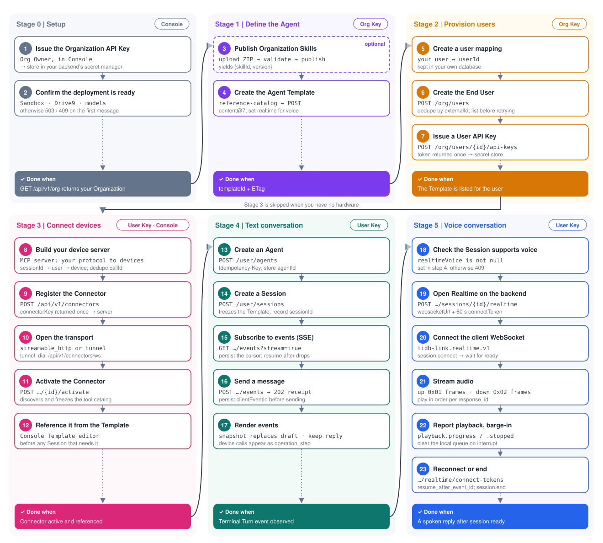

# Development path

Build a TiDB Link integration in this order. Each stage ends with a “done when” check; reach it before moving on. Every step names its credential; exact headers, schemas and errors are in [openapi.yaml](openapi.yaml), and retry and recovery rules are in [reliability.md](reliability.md).



| Stage | Credential | Steps | Done when |
| --- | --- | --- | --- |
| [0. Setup](#stage-0-setup) | Console | 1–2 | `GET /api/v1/org` returns your Organization |
| [1. Define the Agent](#stage-1-define-the-agent) | Organization API Key | 3–4 | You have a `templateId` and its `ETag` |
| [2. Provision users](#stage-2-provision-users) | Organization API Key | 5–7 | The Template is listed for the user |
| [3. Connect devices](#stage-3-connect-devices) | User API Key · Console | 8–12 | The Connector is active and referenced by the Template |
| [4. Text conversation](#stage-4-text-conversation) | User API Key | 13–17 | A terminal Turn event is observed |
| [5. Voice conversation](#stage-5-voice-conversation) | User API Key | 18–23 | A spoken reply arrives after `session.ready` |

Stage 3 is skipped when the Agent drives no hardware. Stage 5 is skipped for text-only products.

Conventions used below: `$TIDB_LINK_BASE_URL` is the service root without a trailing slash; `$TIDB_LINK_ORG_KEY` and `$TIDB_LINK_USER_KEY` come from your secret manager. Generate every `Idempotency-Key` and `clientEventId` once per logical action and persist it before sending (1–128 characters, `^[A-Za-z0-9][A-Za-z0-9_.:-]{0,127}$`).

## Stage 0: Setup

**1. Issue the Organization API Key.** An Organization Owner creates it in Console. Store the `ti_org_…` secret directly in your backend's secret manager; it is shown once. This is a manual step — never paste the key into chat, code or logs.

**2. Confirm the deployment is ready.** The platform operator must have configured Sandbox, Drive9 and at least one model. Otherwise the first message is refused with `503 service_configuration_unavailable` (`details.reason`: `sandbox_unconfigured` / `drive9_unconfigured`) or `409 model_provider_unconfigured`.

```bash
curl --fail-with-body "$TIDB_LINK_BASE_URL/api/v1/org" \
  -H "Authorization: Bearer $TIDB_LINK_ORG_KEY"
```

**Done when** the response's `organization` is the intended one.

## Stage 1: Define the Agent

**3. Publish Organization Skills (optional).** Templates reference Skills by `{skillId, version}`, so publish first:

1. `POST /api/v1/org/skills/uploads` with `Content-Type: application/octet-stream`, exact `Content-Length`, an `Idempotency-Key`, and the ZIP as the body. Validation is asynchronous.
2. Poll `GET /api/v1/org/skills/uploads/{uploadId}` until validation finishes; read its diagnostics.
3. `POST /api/v1/org/skills/uploads/{uploadId}/publish` with a new `Idempotency-Key`. The `202` response only queues publication; `upload.version` may still be `null`.
4. Poll `GET /api/v1/org/skills/uploads/{uploadId}` again until `state` is `done`, then take `upload.version`. `failed` and `aborted` are terminal: read the diagnostics and start a new upload.

**4. Create the Agent Template.** Read `GET /api/v1/org/agent-template-reference-catalog` to choose a Sandbox Profile and published Skill versions, then create the Template with complete content:

```bash
curl --fail-with-body -X POST "$TIDB_LINK_BASE_URL/api/v1/org/agent-templates" \
  -H "Authorization: Bearer $TIDB_LINK_ORG_KEY" \
  -H 'Content-Type: application/json' \
  -H 'Idempotency-Key: <stable-template-create-key>' \
  -d '{"displayName":"Support","content":{"schemaVersion":"agent-template-content@7","realtime":null,"identity":{"agentName":"Support","description":"Customer support"},"sandbox":{"profileId":"<profile-id>"},"instructions":"Explain the next action clearly.","skills":[]}}'
```

- `realtime` is required: `null` for text only, or `{"language":"zh-CN"}` / `{"language":"en-US"}` to enable voice (needed for stage 5).
- Later changes use `PUT /api/v1/org/agent-templates/{templateId}` with the **complete** content, the Template `ETag` in `If-Match` and a new `Idempotency-Key`. Saves apply to Sessions created afterwards.
- Try prompts in Console's Template Playground before wiring users, if useful.

**Done when** you have the `templateId` and its `ETag`.

## Stage 2: Provision users

**5. Create a user mapping.** In your own database, map each application user to a TiDB Link `userId`, and store that user's User API Key reference next to it. Later you will also record `sessionId → your user` here (step 14).

**6. Create the End User.**

```bash
curl --fail-with-body -X POST "$TIDB_LINK_BASE_URL/api/v1/org/users" \
  -H "Authorization: Bearer $TIDB_LINK_ORG_KEY" \
  -H 'Content-Type: application/json' \
  -d '{"displayName":"Application user","externalId":"<your-user-id>"}'
```

`externalId` is unique per Organization; a duplicate returns `409 resource_conflict`. If a create response is lost, `GET /api/v1/org/users` and match `externalId` before creating again. Save `user.userId`.

**7. Issue a User API Key.**

```bash
curl --fail-with-body -X POST "$TIDB_LINK_BASE_URL/api/v1/org/users/<userId>/api-keys" \
  -H "Authorization: Bearer $TIDB_LINK_ORG_KEY" \
  -H 'Content-Type: application/json' \
  -d '{"name":"Application key"}'
```

The secret is `token` (`ti_user_…`), returned only by create and rotate. Store it immediately. After an uncertain issuance, list `GET /api/v1/org/users/<userId>/api-keys`; a lost secret needs `POST /api/v1/org/user-api-keys/<keyId>/rotate`.

**Done when** `GET /api/v1/user/agent-templates` with that User API Key lists the Template from step 4.

## Stage 3: Connect devices

Your hardware connects to **your** device server; that server is registered as a **Connector**, and the Agent calls its tools. Read [protocols/connectors.md](protocols/connectors.md) before implementing it.

**8. Build your device server.** Implement an MCP server (the official MCP SDK works) that exposes device actions as tools and talks to devices with your own protocol (MQTT, WebSocket, …). For every `tools/call`:

- Read the Call Context from `params._meta["tidb-link/context"]`: `callId`, `sessionId`, `organizationId`, `deadline`, `attempt`.
- Resolve `sessionId → your user → device` from your own records, and authorize from that mapping. Never take identity from tool arguments; do not put identity fields in tool schemas.
- Deduplicate side effects by `callId`, and stop work after `deadline`. The platform never retries.
- Return `isError: true` with readable text for business failures; return only `text` and `resource_link` content.
- Verify `Authorization: Bearer <connectorKey>` on every request (`streamable_http`).

**9. Register the Connector** with a User API Key of an active End User (Connectors belong to the Organization):

```bash
curl --fail-with-body -X POST "$TIDB_LINK_BASE_URL/api/v1/connectors" \
  -H "Authorization: Bearer $TIDB_LINK_USER_KEY" \
  -H 'Content-Type: application/json' \
  -d '{"displayName":"Devices","transport":"streamable_http","endpointUrl":"https://devices.example.com/mcp"}'
```

Use `"transport":"tunnel"` without `endpointUrl` when your server has no public address. The `201` response returns `connectorKey` **exactly once**: put it into your device server's secret configuration. `displayName` is unique per Organization.

**10. Open the transport.**

- `streamable_http`: deploy your server at `endpointUrl` (HTTPS, no credentials or fragment).
- `tunnel`: your server dials `wss://<host>/api/v1/connectors/ws` with subprotocol `tidb-link.connector.v1`, `Authorization: Bearer <connectorKey>` and `X-Ti-Connector-Instance: <instance-id>`. Connect at least one instance before activating; reconnect with backoff after any close.

**11. Activate the Connector.**

```bash
curl --fail-with-body -X POST "$TIDB_LINK_BASE_URL/api/v1/connectors/<connectorId>/activate" \
  -H "Authorization: Bearer $TIDB_LINK_USER_KEY" \
  -H 'Content-Type: application/json' \
  -d '{"expectedConnectorVersion":1}'
```

Activation lists your tools and freezes the catalog (≤200 tools, ≤64 KiB per input schema). Registration changes (`PATCH`, `activate`, `deactivate`) need the Connector's current `expectedConnectorVersion`; after a `409`, read the Connector and retry with its version. Credential rotation uses a different counter: `expectedCurrentVersion`, taken from `currentVersion` in `GET …/credential`. While active, edits and credential changes are refused — deactivate first.

**12. Reference the Connector from the Template.** Today this is a Console step: in the Template editor, add the Connector (`conn_…` id) to the Template's tools and save. The Organization Template API does not set this reference, and preserves it across `PUT`. Only active Connectors of the same Organization can be referenced. The model sees each tool as `mcp_<server>__<tool>`.

**Done when** the Connector is active with the expected tools and the saved Template references it. Do this before creating Sessions that need the tools.

## Stage 4: Text conversation

**13. Create an Agent.** `GET /api/v1/user/agent-templates` lists Templates (follow `nextCursor` while `hasMore`). Then:

```bash
curl --fail-with-body -X POST "$TIDB_LINK_BASE_URL/api/v1/user/agents" \
  -H "Authorization: Bearer $TIDB_LINK_USER_KEY" \
  -H 'Content-Type: application/json' \
  -H 'Idempotency-Key: <stable-agent-key>' \
  -d '{"agentTemplateId":"<templateId>"}'
```

The same key replays the original Agent; a new key creates another Agent; the same key with another Template returns `409 agent_creation_conflict`. Save `agent.agentId`.

**14. Create a Session.**

```bash
curl --fail-with-body -X POST "$TIDB_LINK_BASE_URL/api/v1/user/sessions" \
  -H "Authorization: Bearer $TIDB_LINK_USER_KEY" \
  -H 'Content-Type: application/json' \
  -H 'Idempotency-Key: <stable-session-key>' \
  -d '{"agentId":"<agentId>"}'
```

Optional fields: `model` (from `GET /api/v1/agent-models`; omitted means the Organization default) and `billingTag`. The Session freezes the Template content, including Connector references. Save `session.sessionId` **and record `sessionId → your user`** for your device server. Reusing the key with a different body returns `409 session_creation_conflict`.

**15. Subscribe to events (SSE)** before sending:

```bash
curl --no-buffer "$TIDB_LINK_BASE_URL/api/v1/user/sessions/<sessionId>/events?stream=true" \
  -H "Authorization: Bearer $TIDB_LINK_USER_KEY" \
  -H 'Accept: text/event-stream'
```

Parse complete SSE frames across network chunks. Persist each frame's `id` and pass it back as `cursor` when reconnecting. Closing the stream never cancels a Turn. Browsers should receive events through your backend so the User API Key never leaves it.

**16. Send a message.**

```bash
curl -i -X POST "$TIDB_LINK_BASE_URL/api/v1/user/sessions/<sessionId>/events" \
  -H "Authorization: Bearer $TIDB_LINK_USER_KEY" \
  -H 'Content-Type: application/json' \
  -d '{"type":"InputMessageEvent","clientEventId":"<stable-message-id>","data":{"content":[{"type":"text","text":"Turn on the living room light."}]}}'
```

`202` returns the interaction receipt; resending the identical command with the same `clientEventId` returns `200` without a second execution; the same id with different content returns `409`. A message sent while a Turn is running joins that Turn instead of queueing.

**17. Render events.** Each SSE `data` frame is a JSON envelope `{type, sessionId, turnId, createdAt, data}`:

| `type` | Client action |
| --- | --- |
| `agent.session.turn.started` | Start a Turn row. |
| `agent.session.turn.output_text.snapshot` | **Replace** the draft for `turnId` with `data.payload.text`; it may shrink or reset. |
| `agent.session.turn.progress` | Show progress; it is never part of the answer. |
| `agent.session.turn.item.added` | `data.event: "assistant_message"` is the saved reply (`data.payload.text`); `"operation_step"` is a tool call, including Connector calls. |
| `agent.session.turn.failed` | Failure detail (`code`, `details`); a terminal event follows. |
| `agent.session.turn.completed` / `.cancelled` / `.failed` | Terminal (`data.event: "turn_finished"`, `status` `succeeded` / `interrupted` / `failed`). |

Tolerate unknown types. Confirm the result with `GET /api/v1/user/sessions/<sessionId>/interactions/<clientEventId>` and `GET /api/v1/user/sessions/<sessionId>/turns/<turnId>`.

**Done when** a terminal Turn event is observed and the Turn reads back the same reply; with stage 3, the device tool call appears as an `operation_step`.

## Stage 5: Voice conversation

Voice is a second way to talk to the same Session. Read [protocols/realtime-voice.md](protocols/realtime-voice.md) for frames, formats and errors.

**18. Check the Session supports voice.** `GET /api/v1/user/sessions/<sessionId>` must show a non-null `realtimeVoice`, which comes from the Template's `realtime` setting at Session creation (step 4). Otherwise opening voice returns `409 realtime_not_enabled`.

**19. Open Realtime on the backend.**

```bash
curl --fail-with-body -X POST "$TIDB_LINK_BASE_URL/api/v1/user/sessions/<sessionId>/realtime" \
  -H "Authorization: Bearer $TIDB_LINK_USER_KEY"
```

The `201` response has `realtimeConnection` plus `websocketUrl`, `connectToken` and `connectTokenExpiresAt`. Hand only those three grant fields to the client; the token lasts 60 seconds and works once. An optional JSON `audio` body selects formats (PCM16 by default; Opus output for constrained devices). `409 realtime_connection_live` means one is already open: read `GET …/realtime` and resume it instead.

**20. Connect the client WebSocket.** Open `websocketUrl` with subprotocol `tidb-link.realtime.v1` and send, as the first frame within 10 seconds:

```json
{ "type": "session.connect", "connect_token": "<connectToken>", "endpointing": { "mode": "client" } }
```

Wait for `session.ready` and configure capture and playback from its effective `audio` settings. `client` endpointing means your client sends `input_audio.activity` `start` / `end` around each utterance; `server` lets the provider detect speech.

**21. Stream audio.** Send microphone audio as binary frames (`0x01` + 4-byte big-endian counter + audio) or `input_audio.append`. Play binary `0x02` frames or `response.audio.delta` in `chunk_index` order for the current `response_id`. Show `transcript.partial` / `transcript.final`.

**22. Report playback and handle barge-in.** Report the last audible chunk with `playback.progress`. When the user interrupts, stop playback, discard queued audio and send `playback.stopped` (`reason: "user_interrupt"`) or `input_audio.clear`.

**23. Reconnect or end.** After an unexpected close, mint a new token with `POST /api/v1/user/sessions/<sessionId>/realtime/connect-tokens` and reconnect with `resume_after_event_id` set to the last received `event_id` within 60 seconds. End with `{"type":"session.end"}` or `DELETE /api/v1/user/sessions/<sessionId>/realtime`. Delegated voice tasks become ordinary Turns; read them from the Session SSE stream or `GET …/timeline`.

**Done when** a spoken reply plays after `session.ready`, and the voice exchange appears in the Session timeline.
