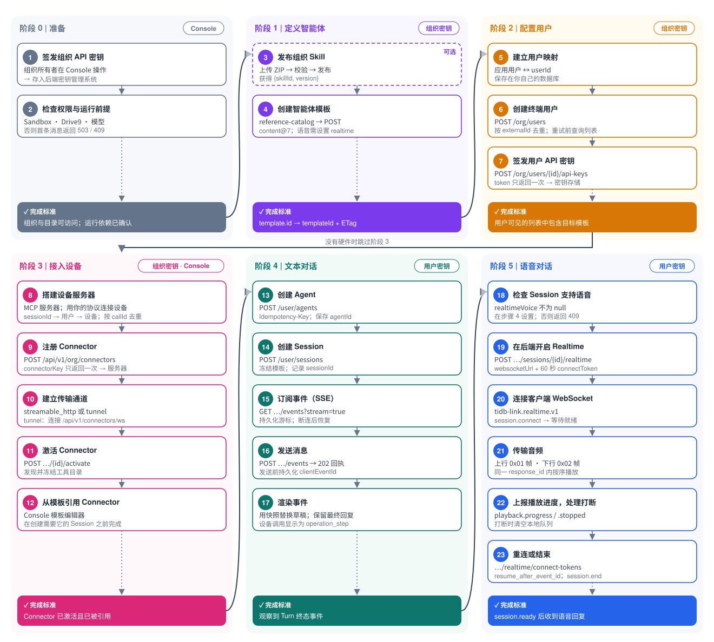

# 接入流程

[English](../development-path.md) | 简体中文

> 翻译基线：英文文档提交 [`a152eb4`](https://github.com/mem9-ai/tidblink-dev-guide/commit/a152eb4abcc08a6241fec90d41efd8e1b3989872)（2026-10-21）。接口定义以共用 OpenAPI 为准。

按以下顺序接入 TiDB Link。每个阶段都有完成标准，达到后再进入下一阶段。各步骤均标明所用凭据；精确的请求头、数据结构和错误见 [openapi.yaml](../openapi.yaml)，重试与恢复规则见[可靠性与故障排查](reliability.md)。



| 阶段 | 凭据 | 步骤 | 完成标准 |
| --- | --- | --- | --- |
| [0. 准备](#stage-0-setup) | Console | 1–2 | 可访问组织和模板目录；运维人员已确认运行依赖 |
| [1. 定义智能体](#stage-1-define-the-agent) | 组织 API 密钥 | 3–4 | 获得 `templateId` 及其 `ETag` |
| [2. 配置用户](#stage-2-provision-users) | 组织 API 密钥 | 5–7 | 用户可见的模板列表包含目标模板 |
| [3. 接入设备](#stage-3-connect-devices) | 组织 API 密钥 · Console | 8–12 | Connector 已激活，且模板已引用它 |
| [4. 文本对话](#stage-4-text-conversation) | 用户 API 密钥 | 13–17 | 观察到 Turn 终态事件 |
| [5. 语音对话](#stage-5-voice-conversation) | 用户 API 密钥 | 18–23 | `session.ready` 之后收到语音回复 |

智能体不控制硬件时跳过阶段 3；纯文本产品跳过阶段 5。

下文约定：`$TIDB_LINK_BASE_URL` 是不带末尾斜杠的服务根地址；`$TIDB_LINK_ORG_KEY` 和 `$TIDB_LINK_USER_KEY` 来自密钥管理系统。每个逻辑操作只生成一个 `Idempotency-Key` 或 `clientEventId`，并在发送前持久化（1–128 个字符，符合 `^[A-Za-z0-9][A-Za-z0-9_.:-]{0,127}$`）。

<a id="stage-0-setup"></a>

## 阶段 0：准备

**1. 签发组织 API 密钥。** 由组织所有者在 Console 创建。将 `ti_org_…` 机密值直接存入后端的密钥管理系统；它只显示一次。这一步是手动操作，绝不能把密钥粘贴到聊天、代码或日志中。

**2. 检查访问权限与运行前提。** 平台运维人员必须配置好 Sandbox、Drive9 和至少一个模型。否则首条消息会被拒绝，返回 `503 service_configuration_unavailable`（`details.reason` 为 `sandbox_unconfigured` / `drive9_unconfigured`）或 `409 model_provider_unconfigured`。

```bash
curl --fail-with-body "$TIDB_LINK_BASE_URL/api/v1/org" \
  -H "Authorization: Bearer $TIDB_LINK_ORG_KEY"
```

还需使用组织 API 密钥读取模板引用目录：

```bash
curl --fail-with-body "$TIDB_LINK_BASE_URL/api/v1/org/agent-template-reference-catalog" \
  -H "Authorization: Bearer $TIDB_LINK_ORG_KEY"
```

从 `sandboxes[].id` 选择 Sandbox（例如，只有当前部署列出 `standard-v1` 时才能使用它）。组织接口返回成功或 `/readyz` 成功，**并不代表**模型、Sandbox 或 Drive9 已通过执行验证。请运维人员确认这些依赖；在步骤 7 使用用户 API 密钥检查可选模型，并在阶段 4 通过首个成功的 Turn 验证执行。

若要执行阶段 3，**现在**就应准备好能够编辑同一组织模板的 Console 账号。MSP 创建的受管组织不会自动包含 Console 成员。组织 API 密钥可以注册 Connector，但无法将其关联到模板。如果缺少该权限，应在注册资源前暂停设备接入；文本和语音可以单独继续。

**完成标准：** 响应中的 `organization` 是目标组织，目录列出了可用的 Sandbox Profile，运维人员已确认运行依赖，并且（使用设备时）已具备 Console 模板访问权限。

<a id="stage-1-define-the-agent"></a>

## 阶段 1：定义智能体

**3. 发布组织 Skill（可选）。** 模板按 `{skillId, version}` 引用 Skill，因此要先发布。最小 ZIP 在根目录包含 `SKILL.md`（压缩该文件，不要把它的父目录作为压缩包根层级）：

```markdown
---
name: guide-check
description: A minimal integration check.
---
When asked to verify this Skill, include GUIDE-SKILL-OK in your reply.
```

例如，在空目录中保存该文件，再执行 `zip skill.zip SKILL.md`。辅助文件可以与它放在同一层级。

1. 调用 `POST /api/v1/org/skills/uploads`，携带 `Content-Type: application/octet-stream`、准确的 `Content-Length` 和 `Idempotency-Key`，请求体为 ZIP。校验是异步的。
2. 轮询 `GET /api/v1/org/skills/uploads/{uploadId}`，直到 `upload.state` 为 `awaiting_confirmation`，并读取诊断信息。只有此时才能发布；`failed` 或 `aborted` 的上传不能发布。
3. 调用 `POST /api/v1/org/skills/uploads/{uploadId}/publish`，使用新的 `Idempotency-Key`。`202` 只表示发布已排队；`upload.version` 仍可能为 `null`。
4. 再次轮询 `GET /api/v1/org/skills/uploads/{uploadId}`，直到 `upload.state` 为 `done`，然后获取 `upload.version`。`failed` 和 `aborted` 都是终态：读取诊断信息并重新上传。

**4. 创建智能体模板（Agent Template）。** 读取 `GET /api/v1/org/agent-template-reference-catalog`，选择 Sandbox Profile（`sandboxes[].id` → `content.sandbox.profileId`）和已发布的 Skill 版本，然后以完整内容创建模板：

```bash
curl --fail-with-body -X POST "$TIDB_LINK_BASE_URL/api/v1/org/agent-templates" \
  -H "Authorization: Bearer $TIDB_LINK_ORG_KEY" \
  -H 'Content-Type: application/json' \
  -H 'Idempotency-Key: <stable-template-create-key>' \
  -d '{"displayName":"Support","content":{"schemaVersion":"agent-template-content@7","realtime":null,"identity":{"agentName":"Support","description":"Customer support"},"sandbox":{"profileId":"<profile-id>"},"instructions":"Explain the next action clearly.","skills":[]}}'
```

- `realtime` 是必填字段：纯文本设为 `null`；启用语音则使用 `{"language":"zh-CN"}` / `{"language":"en-US"}`（阶段 5 需要）。
- 后续修改使用 `PUT /api/v1/org/agent-templates/{templateId}`，提交**完整**内容，在 `If-Match` 中携带模板的 `ETag`，并使用新的 `Idempotency-Key`。保存仅影响之后创建的 Session。
- 如有需要，可在接入用户前使用 Console 的 Template Playground 测试提示词。

**完成标准：** 已将响应中的 `template.id` 保存为 `templateId`，同时保存其 `ETag`（也可从 `template.etag` 获取）。使用 `curl -i` 查看响应头。

<a id="stage-2-provision-users"></a>

## 阶段 2：配置用户

**5. 建立用户映射。** 在自己的数据库中，将每个应用用户映射到 TiDB Link `userId`，并一同保存该用户的 API 密钥引用。之后还需在此记录 `sessionId → 应用用户`（步骤 14）。

**6. 创建终端用户（End User）。**

```bash
curl --fail-with-body -X POST "$TIDB_LINK_BASE_URL/api/v1/org/users" \
  -H "Authorization: Bearer $TIDB_LINK_ORG_KEY" \
  -H 'Content-Type: application/json' \
  -d '{"displayName":"Application user","externalId":"<your-user-id>"}'
```

`externalId` 在组织内唯一；重复时返回 `409 resource_conflict`。如果创建响应丢失，先调用 `GET /api/v1/org/users` 并匹配 `externalId`，再决定是否重新创建。保存 `user.userId`。

**7. 签发用户 API 密钥。**

```bash
curl --fail-with-body -X POST "$TIDB_LINK_BASE_URL/api/v1/org/users/<userId>/api-keys" \
  -H "Authorization: Bearer $TIDB_LINK_ORG_KEY" \
  -H 'Content-Type: application/json' \
  -d '{"name":"Application key"}'
```

机密字段为 `token`（`ti_user_…`），只在创建和轮换时返回，必须立即保存。若不确定签发是否成功，调用 `GET /api/v1/org/users/<userId>/api-keys` 查看列表；密钥丢失时需调用 `POST /api/v1/org/user-api-keys/<keyId>/rotate`。

获得用户 API 密钥后，检查模型可用性：

```bash
curl --fail-with-body "$TIDB_LINK_BASE_URL/api/v1/agent-models" \
  -H "Authorization: Bearer $TIDB_LINK_USER_KEY"
```

`effectiveAllowedModels` 必须非空。在步骤 14 中明确选择此列表里的一个模型；`effectiveDefaultModel` 是建议选项。存储的 `organizationDefaultModel` 可能不可用。此目录只检查模型选择，不能验证完整的 Sandbox/Drive9 执行。

**完成标准：** 有可选模型，且使用该用户 API 密钥读取 `GET /api/v1/user/agent-templates` 时能看到步骤 4 的模板。将 `templates[].agentTemplateId` 与已保存的 `templateId` 匹配；列表还可能包含内置 **Default Agent** 模板，不要直接选第一项。

<a id="stage-3-connect-devices"></a>

## 阶段 3：接入设备

硬件连接**你的**设备服务器；服务器注册为 **Connector**，智能体调用它提供的工具。实现前请阅读 [Connector 协议](protocols/connectors.md)。

**8. 搭建设备服务器。** 实现一个 MCP 服务器（可使用官方 MCP SDK），将设备操作暴露为工具，并通过自己的协议（MQTT、WebSocket 等）与设备通信。每次处理 `tools/call` 时：

- 从 `params._meta["tidb-link/context"]` 读取调用上下文：`callId`、`sessionId`、`organizationId`、`deadline`、`attempt`。
- 从自己的记录解析 `sessionId → 应用用户 → 设备`，并依据该映射授权。绝不能从工具参数获取身份；不要在工具 schema 中加入身份字段。
- 按 `callId` 对副作用去重，超过 `deadline` 后停止工作。平台不会重试。
- 业务失败返回 `isError: true` 和可读说明；内容只返回 `text` 和 `resource_link`。
- 验证每次请求的 `Authorization: Bearer <connectorKey>`（`streamable_http`）。

**9. 使用组织 API 密钥注册 Connector**（Connector 属于组织）：

```bash
curl --fail-with-body -X POST "$TIDB_LINK_BASE_URL/api/v1/org/connectors" \
  -H "Authorization: Bearer $TIDB_LINK_ORG_KEY" \
  -H 'Content-Type: application/json' \
  -d '{"displayName":"Devices","transport":"streamable_http","endpointUrl":"https://devices.example.com/mcp"}'
```

服务器没有公网地址时，使用 `"transport":"tunnel"`，不传 `endpointUrl`。`201` 响应中的 `connectorKey` **只返回一次**：将其存入设备服务器的机密配置。`displayName` 在组织内唯一。

**10. 建立传输通道。**

- `streamable_http`：将服务器部署在 `endpointUrl`（HTTPS，URL 不含凭据或片段）。
- `tunnel`：服务器连接 `wss://<host>/api/v1/connectors/ws`，使用子协议 `tidb-link.connector.v1`，携带 `Authorization: Bearer <connectorKey>` 和 `X-Ti-Connector-Instance: <instance-id>`。激活前至少连接一个实例；每次关闭后采用退避重连。先阅读[多副本限制](protocols/connectors.md#multi-replica-limit)：一个已连接实例不代表每个平台副本都已就绪。除非运维人员能确保发现和工具调用都路由到持有就绪连接的副本，否则优先使用 `streamable_http`。

**11. 激活 Connector。**

```bash
curl --fail-with-body -X POST "$TIDB_LINK_BASE_URL/api/v1/org/connectors/<connectorId>/activate" \
  -H "Authorization: Bearer $TIDB_LINK_ORG_KEY" \
  -H 'Content-Type: application/json' \
  -d '{"expectedConnectorVersion":1}'
```

激活会列出工具并冻结目录（最多 200 个工具，每个输入 schema 不超过 64 KiB）。注册信息变更（`PATCH`、`activate`、`deactivate`）需要 Connector 当前的 `expectedConnectorVersion`；版本冲突时，重新读取 Connector，使用当前版本重新应用变更。如果 `409` 表示没有就绪的 tunnel 连接，这是传输或路由问题，不是版本冲突。凭据轮换使用另一计数器 `expectedCurrentVersion`，取自 `GET …/credential` 中的 `currentVersion`。激活期间禁止编辑和凭据变更，必须先停用。

**12. 从模板引用 Connector（需要 Console）。**

1. 使用有模板编辑权限的账号登录，选择与组织 API 密钥相同的组织。
2. 打开步骤 4 创建的模板。在 **MCP & Connectors** 中，按 `conn_…` ID 或显示名称选择已激活的 Connector 并保存。
3. 重新打开编辑器，确认引用仍在。步骤 14 中创建**新 Session**，再在步骤 17 验证实际工具调用。

组织模板 API 的公开内容 schema 有意不包含 `tools`。向其 `POST` 或 `PUT` 提交 `content.tools.mcp` 会返回 `400 validation_error`；`PUT` 会保留 Console 管理的引用，而组织 API 的读取结果不会暴露这些引用。目前没有可以替代这一步的 Customer API。如果组织没有 Console 成员，请先让管理员安排访问权限，再继续设备接入。只能引用同一组织内已激活的 Connector。模型看到的工具名为 `mcp_<server>__<tool>`。

**完成标准：** Connector 已激活且包含预期工具，保存的模板已引用它。在创建需要这些工具的 Session 前完成此步骤。

<a id="stage-4-text-conversation"></a>

## 阶段 4：文本对话

**13. 创建 Agent。** `GET /api/v1/user/agent-templates` 列出模板（`hasMore` 为真时继续使用 `nextCursor`）。选择 `agentTemplateId` 与步骤 4 保存的 `template.id` 一致的条目，不要选择第一项或内置 Default Agent。然后调用：

```bash
curl --fail-with-body -X POST "$TIDB_LINK_BASE_URL/api/v1/user/agents" \
  -H "Authorization: Bearer $TIDB_LINK_USER_KEY" \
  -H 'Content-Type: application/json' \
  -H 'Idempotency-Key: <stable-agent-key>' \
  -d '{"agentTemplateId":"<templateId>"}'
```

相同幂等键会返回原 Agent；新键会创建另一个 Agent；相同键配合另一个模板会返回 `409 agent_creation_conflict`。保存 `agent.agentId`。

**14. 创建 Session。**

```bash
curl --fail-with-body -X POST "$TIDB_LINK_BASE_URL/api/v1/user/sessions" \
  -H "Authorization: Bearer $TIDB_LINK_USER_KEY" \
  -H 'Content-Type: application/json' \
  -H 'Idempotency-Key: <stable-session-key>' \
  -d '{"agentId":"<agentId>","model":"<model-from-effectiveAllowedModels>"}'
```

`model` 是可选字段，但从 `GET /api/v1/agent-models` 明确选择模型可避免默认模型不可用的问题。省略时，创建流程先尝试当前激活发布版本中可选的默认模型，再尝试组织默认模型，也可能以 `model_provider_unconfigured` 拒绝请求；不要假设一定会使用存储的组织默认模型或目录中的最终兜底建议。`billingTag` 也是可选的。为资源配置预留时间（腾讯云验证中约为 10 秒）；超时后使用相同幂等键和请求体重试。Session 冻结模板内容，包括 Connector 引用。保存 `session.sessionId`，并为设备服务器**记录 `sessionId → 应用用户`**。相同键配合不同请求体会返回 `409 session_creation_conflict`。

**15. 发送前先订阅事件（SSE）：**

```bash
curl --no-buffer "$TIDB_LINK_BASE_URL/api/v1/user/sessions/<sessionId>/events?stream=true" \
  -H "Authorization: Bearer $TIDB_LINK_USER_KEY" \
  -H 'Accept: text/event-stream'
```

跨网络数据块组装并解析完整 SSE 帧。持久化每帧的 `id`，重连时作为 `cursor` 传回。关闭流不会取消 Turn。浏览器应通过后端接收事件，确保用户 API 密钥始终留在后端。

**16. 发送消息。**

```bash
curl -i -X POST "$TIDB_LINK_BASE_URL/api/v1/user/sessions/<sessionId>/events" \
  -H "Authorization: Bearer $TIDB_LINK_USER_KEY" \
  -H 'Content-Type: application/json' \
  -d '{"type":"InputMessageEvent","clientEventId":"<stable-message-id>","data":{"content":[{"type":"text","text":"Turn on the living room light."}]}}'
```

`202` 返回交互回执；使用相同 `clientEventId` 重发完全相同的命令，会返回 `200`，不会再次执行；相同 ID 配合不同内容会返回 `409`。Turn 运行期间发送的消息会加入该 Turn，而不是排队。

**17. 渲染事件。** 每个 SSE `data` 帧都是 JSON 信封 `{type, sessionId, turnId, createdAt, data}`：

| `type` | 客户端操作 |
| --- | --- |
| `agent.session.turn.started` | 创建一条 Turn 展示记录。 |
| `agent.session.turn.output_text.snapshot` | 使用 `data.payload.text` **替换**该 `turnId` 的草稿；内容可能缩短或重置。 |
| `agent.session.turn.progress` | 展示进度；它不属于回答内容。 |
| `agent.session.turn.item.added` | `data.event: "assistant_message"` 是已保存的回复（`data.payload.text`）；`"operation_step"` 是工具调用，包括 Connector 调用。 |
| `agent.session.turn.failed` | 失败详情（`code`、`details`）；之后还有终态事件。 |
| `agent.session.turn.completed` / `.cancelled` / `.failed` | 终态（`data.event: "turn_finished"`，`data.payload.status` 为 `succeeded` / `interrupted` / `failed`）。 |

应容忍未知事件类型。通过 `GET /api/v1/user/sessions/<sessionId>/interactions/<clientEventId>` 和 `GET /api/v1/user/sessions/<sessionId>/turns/<turnId>` 确认结果。

**完成标准：** 观察到 Turn 终态事件，且读取 Turn 得到相同回复；若完成了阶段 3，设备工具调用应以 `operation_step` 出现。

<a id="stage-5-voice-conversation"></a>

## 阶段 5：语音对话

语音是与同一个 Session 交互的另一种方式。帧、格式和错误详见[实时语音协议](protocols/realtime-voice.md)。

**18. 检查 Session 是否支持语音。** 首先使用用户 API 密钥读取 `GET /api/v1/realtime-models`：其 `defaultModel` 必须对应 `models` 中 `available: true`、支持所需语言和语音端点检测模式的条目。默认模型不可用时，语音不会自动回退。创建新语音 Session 前先做此检查。`GET /api/v1/user/sessions/<sessionId>` 必须显示非空的 `realtimeVoice`，该值来自创建 Session 时模板的 `realtime` 设置（步骤 4）；否则开启语音会返回 `409 realtime_not_enabled`。

**19. 在后端开启 Realtime。**

```bash
curl --fail-with-body -X POST "$TIDB_LINK_BASE_URL/api/v1/user/sessions/<sessionId>/realtime" \
  -H "Authorization: Bearer $TIDB_LINK_USER_KEY"
```

`201` 响应包含 `realtimeConnection`，以及 `websocketUrl`、`connectToken`、`connectTokenExpiresAt`。只将这三个授权字段交给客户端；令牌有效期为 60 秒，且只能用一次。可选的 JSON `audio` 请求体用于选择格式（默认 PCM16；资源受限设备可选择 Opus 输出）。`409 realtime_connection_live` 表示已有连接：读取 `GET …/realtime` 并恢复它。

**20. 建立客户端 WebSocket。** 使用子协议 `tidb-link.realtime.v1` 连接 `websocketUrl`，在 10 秒内发送以下首帧：

```json
{ "type": "session.connect", "connect_token": "<connectToken>", "endpointing": { "mode": "client" } }
```

等待 `session.ready`，再按其生效的 `audio` 设置配置采集和播放。`client` 端点检测要求客户端在每段话的前后发送 `input_audio.activity` 的 `start` / `end`；`server` 则由提供方检测语音。

**21. 传输音频。** 使用二进制帧（`0x01` + 4 字节大端计数器 + 音频）或 `input_audio.append` 发送麦克风音频。对当前 `response_id`，按 `chunk_index` 顺序播放二进制 `0x02` 帧或 `response.audio.delta`。展示 `transcript.partial` / `transcript.final`。

**22. 上报播放进度并处理打断。** 用 `playback.progress` 上报最后实际播放的音频块。用户打断时停止播放、丢弃排队音频，并发送 `playback.stopped`（`reason: "user_interrupt"`）或 `input_audio.clear`。

**23. 重连或结束。** 意外关闭后，调用 `POST /api/v1/user/sessions/<sessionId>/realtime/connect-tokens` 获取新令牌，在 60 秒内重连，并将 `resume_after_event_id` 设为最后收到的 `event_id`。通过 `{"type":"session.end"}` 或 `DELETE /api/v1/user/sessions/<sessionId>/realtime` 结束连接。语音委派任务会成为普通 Turn，可从 Session SSE 流或 `GET …/timeline` 读取。

**完成标准：** `session.ready` 之后成功播放语音回复，并且 Session 时间线中出现此次语音交互。
